# 💻 Handsome the Police Dog

Starter files for the first coding exercise in Web Design 1. You will turn plain text about
**Handsome**, Cincinnati's first unofficial police dog, into a basic HTML web page and publish it
with GitHub Pages.

This repo also includes the editor and Git configuration and the pull request template that every
assignment in this course uses.

> [!NOTE]
> `.editorconfig`, `.gitattributes`, `.gitignore`, `.noai`, and the `.github` folder are
> setup files that keep assignments consistent. Leave them alone. `handsome.txt`,
> `handsome.jpg`, and `handsome-today.jpg` are your starter content — keep them in the repo.

## 📋 Assignment Requirements

> [!IMPORTANT]
> **Start here: [read ASSIGNMENT.md →](ASSIGNMENT.md)**

It has the overview, a guide to the companion videos in Canvas, and a final checklist. Read it before you start, and check it again before you submit. This `README` only covers how to publish and submit your work.

## 🏁 Getting Started

1. **Create your own repo from this template.**
   - At the top of this repo on GitHub, click the green **Use this template** button. (If a
     menu opens, choose **Create a new repository**.)

     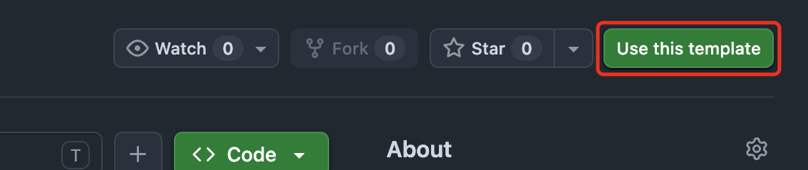
   - Set **Owner** to your GitHub account.
   - Give it a **Repository name** — use the assignment name, like `handsome-the-police-dog`.

     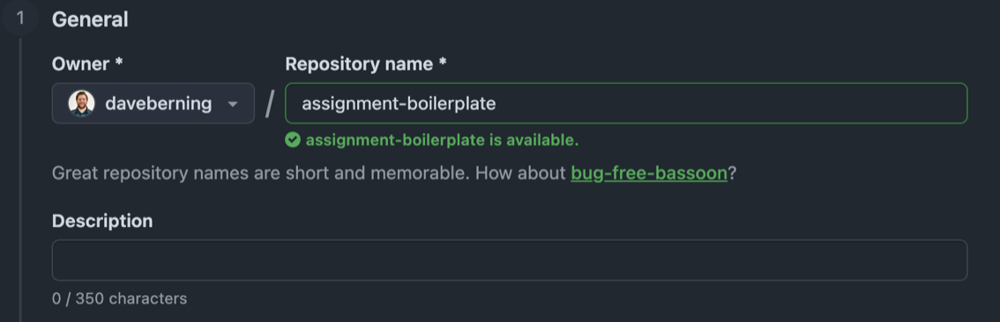
   - Set visibility to **Public** (GitHub Pages needs a public repo on a free account).

     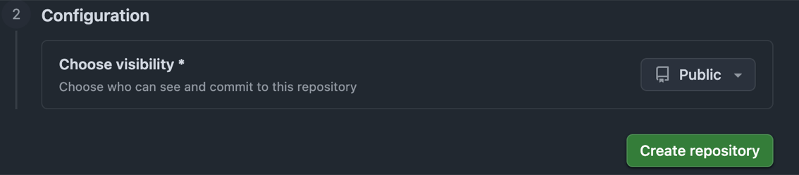
   - Click **Create repository**. GitHub takes you to your new repo.
2. **Open your new repo in GitHub Desktop.**
   - Check that the repo name at the top of the page is `<your-username>/<repo-name>`, not
     this template.
   - Click the green **Code** button → **Open with GitHub Desktop**.
   - GitHub Desktop opens and asks where to save the repo. Pick a folder on your computer
     and click **Clone**.

   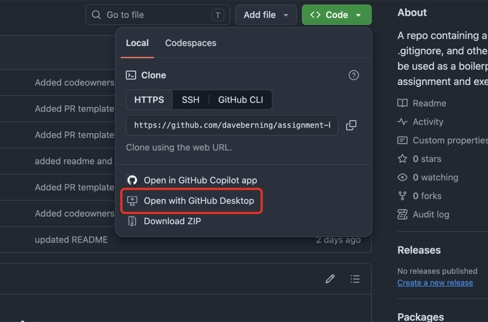

   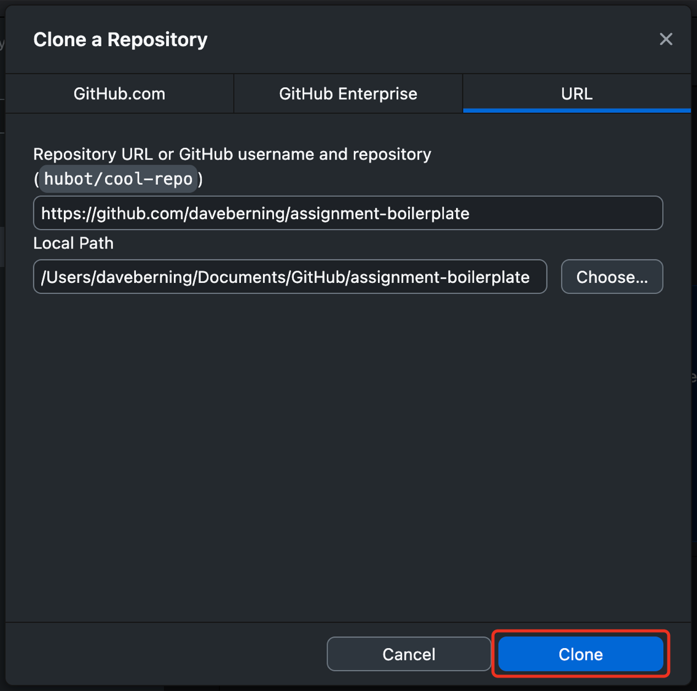
3. In GitHub Desktop, create your assignment branch: **Current Branch** → **New Branch** and name it `develop`.
4. Click **Open in \<editor\>** to open the folder in your code editor and start working.

## 📂 Where Your Files Go

Create your files in the **root folder** of this repo — the same folder as this README.
GitHub Pages publishes from the root, so `index.html` has to live there or your site will 404. Your files should look like this:

```
index.html
handsome.jpg
handsome-today.jpg
```

For this first exercise, keep everything in the root folder — the images are already there, so
`` just works. In later assignments you will group assets into subfolders
like `css/`, `js/`, and `images/`.

## 🤖 AI Policy

Work on this assignment must be your own. Do not use AI coding assistants — including
GitHub Copilot, Cursor, ChatGPT, Claude, or JetBrains AI Assistant — to generate,
complete, or rewrite your code.

You should be able to explain any line of your submission. You may be asked to do so.

This repo includes a `.noai` file, which disables JetBrains AI Assistant for the project
in IDEs like WebStorm. Leave it in place. It is a reminder of the policy above, not a
substitute for it — following the policy is still your responsibility.

## 🚀 Publishing to GitHub Pages

Your work has to be live on the web before you can submit it.

1. **Commit your work in GitHub Desktop.**
   - Make sure **Current Branch** says `develop`.
   - Enter a summary in the bottom-left box, like `Create index.html`, and click
     **Commit to develop**.

   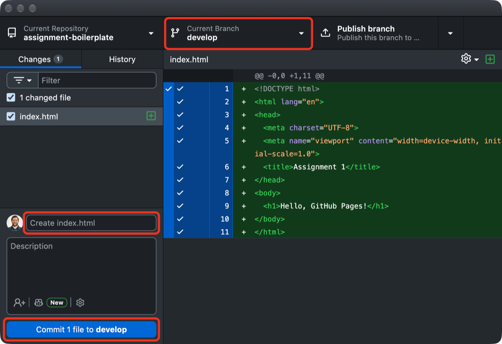
2. **Push your work to GitHub.**
   - The first time, click **Publish branch** at the top. This creates your `develop`
     branch on GitHub.
   - After that, the same button says **Push origin**. Click it after every commit.

   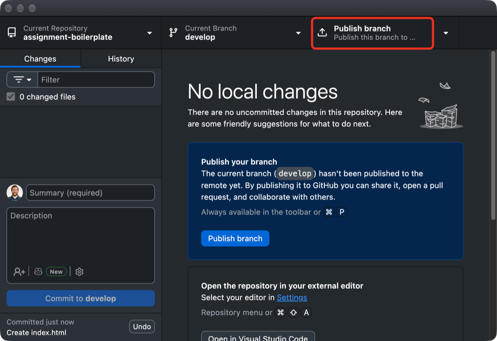
3. **Turn on GitHub Pages.**
   - On GitHub, open **your** repo (the one you created from the template) and go to
     **Settings** → **Pages**.
   - Under **Branch**, click the **None** dropdown and pick `develop`.

     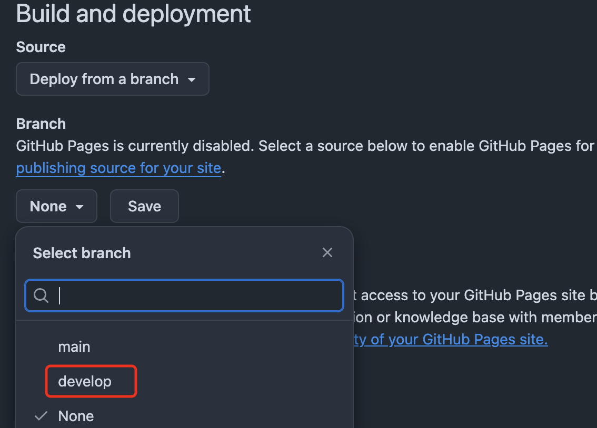
   - Make sure **Source** is *Deploy from a branch* and the folder is `/ (root)`, then click
     **Save**.

     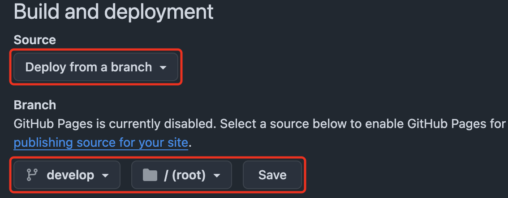
4. **Open your live site.** The first deploy takes a minute or two. Reload the Pages
   settings screen until it says **Your site is live at**, then click the URL:
   ```
   https://<your-username>.github.io/<repo-name>/
   ```

   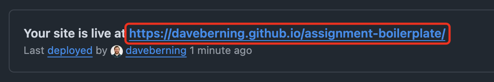

   Confirm the page loads correctly — the right content, no missing images, no broken styles.

**🛠️ Troubleshooting**

- **404 page:** make sure an `index.html` exists in the root of the branch you selected, and that the filename is lowercase.
- **Old version showing:** Pages caches aggressively. Wait a minute, then hard refresh (<kbd>Cmd</kbd>/<kbd>Ctrl</kbd> + <kbd>Shift</kbd> + <kbd>R</kbd>).
- **Nothing deployed:** check the **Actions** tab for a failed `pages build and deployment` run.

## 📬 Submitting the Assignment

Submission has two parts: publish the site, then submit a pull request URL in Canvas.

1. **Publish to GitHub Pages** using the steps above. Do this first.
2. **Open a pull request into `main`.**
   - In **GitHub Desktop**, with `develop` selected, click **Preview Pull Request**, then
     **Create pull request**. (You can also use **Branch** → **Create Pull Request**.) The
     pull request form opens in your browser.

     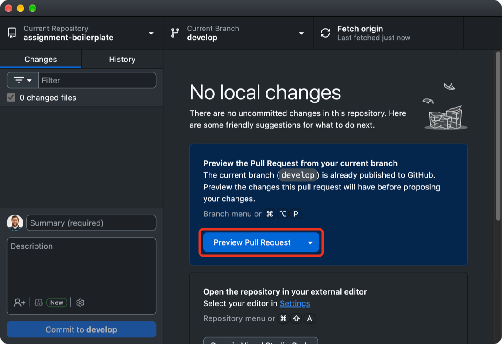
   - Confirm **base** is `main` and **compare** is `develop`, and title it with the
     assignment name.

     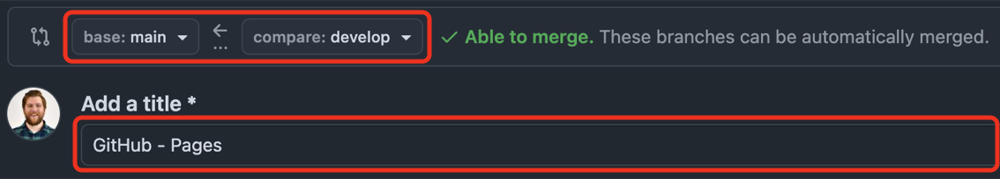
   - The description is pre-filled with a template. Fill in every section: paste your live
     GitHub Pages URL under **Live GitHub Pages URL**, write a short **Summary**, check off
     the **Checklist** by changing each `[ ]` to `[x]`, and answer the **Reflection**.
     **Notes for your instructor** is optional. Leave the `<!-- -->` hint lines as they are;
     they're hidden once the pull request is created.

     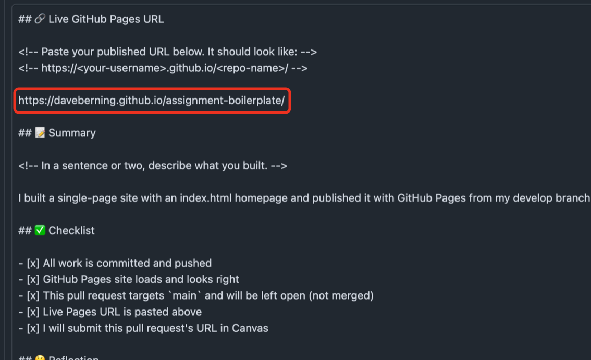
   - Click **Create pull request**.

     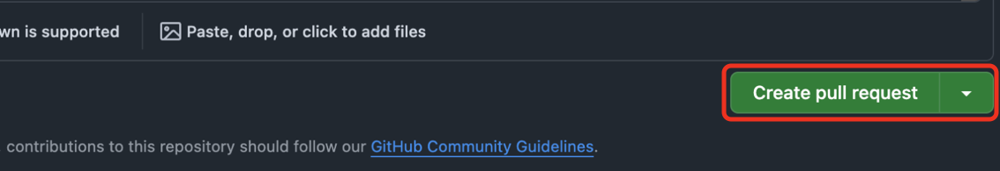
   - Your pull request opens. It should say **Open** and show it merging `develop` into
     `main`. Don't merge it.

     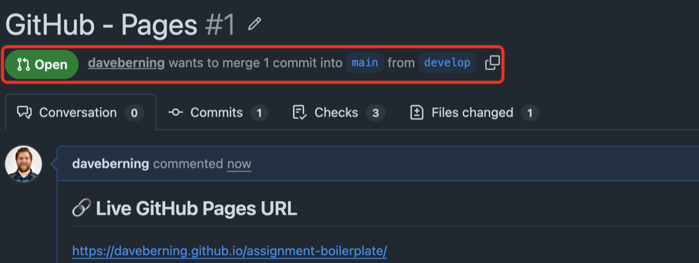
3. **Submit the pull request URL in Canvas.**
   - Copy the pull request URL from your browser's address bar. It looks like
     `https://github.com/<your-username>/<repo-name>/pull/1`.
   - Open the matching assignment in Canvas and click the red **Start Assignment** button.
     The page scrolls down to the submission form.

     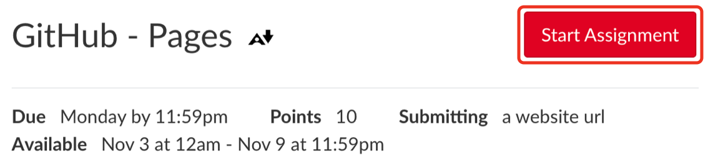
   - On the **Website URL** tab, paste your **pull request URL** into the **Website URL**
     field. Don't paste your GitHub Pages URL here; that goes in the pull request.
   - Optional: add a note for your instructor in **Comments**.
   - Click the red **Submit Assignment** button.

     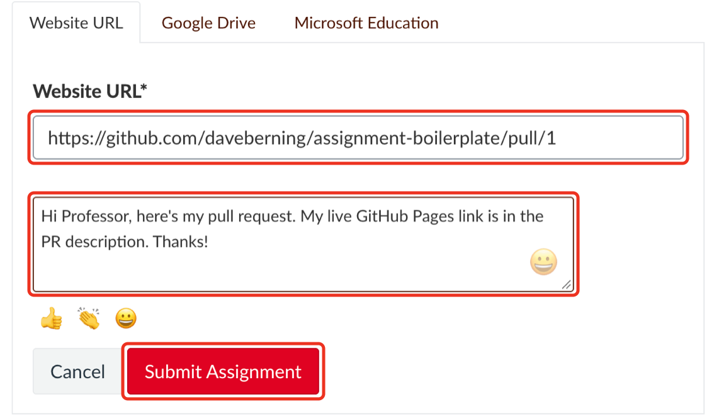

> [!CAUTION]
> Late or missing submissions are graded on what is in the pull request at the deadline, so push your final commits before you submit.
